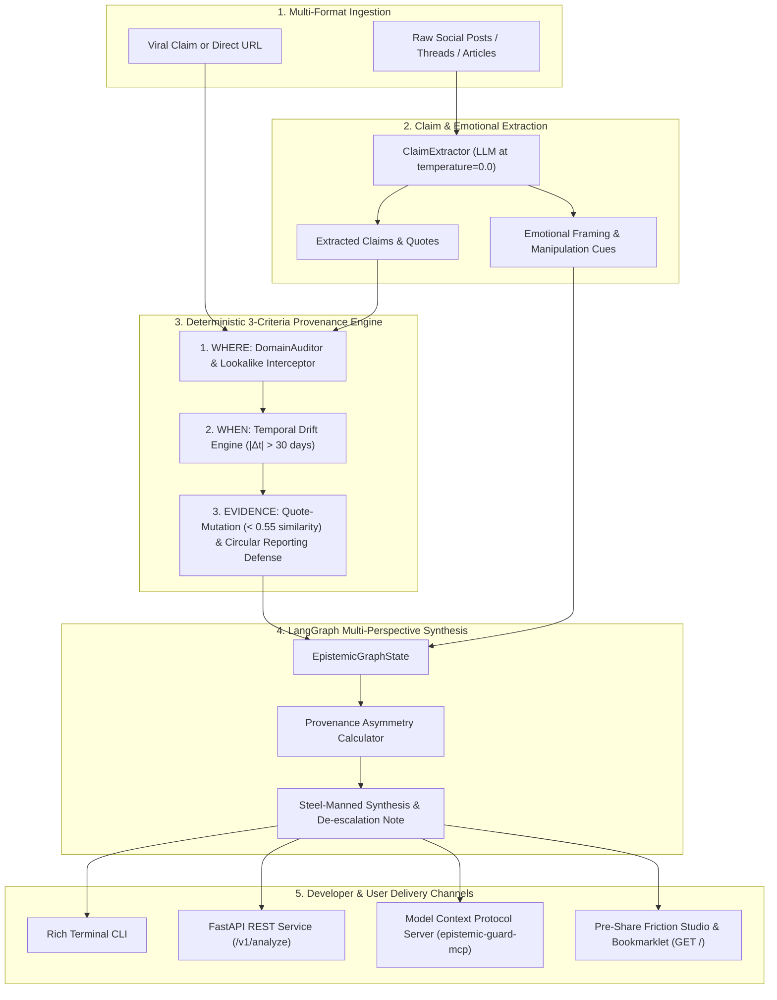

<div align="center">

# 🛡️ Epistemic Guard

**Open-Source, Model-Agnostic Provenance Auditing & Two-Sided Listening Engine**

[](pyproject.toml)
[](https://www.python.org/downloads/)
[](https://docs.pydantic.dev/)
[](tests/)
[](https://github.com/Sandeep-Hipparagi/epistemic-guard/actions/workflows/ci.yml)
[](benchmarks/)
[](src/epistemic_guard/interfaces/mcp_server.py)
[](LICENSE)

> **PyPI distribution:** this project publishes as [`provenance-guard`](https://pypi.org/project/provenance-guard/) (the `epistemic-guard` name is taken on PyPI by an unrelated package).
> Install with `pip install provenance-guard` and import as `import epistemic_guard`.

*A deterministic, zero-hallucination verification foundation to halt viral misinformation before emotional contagion spreads.*

[Quickstart](#-60-second-quickstart) • [The Philosophy](#-the-problem--epistemic-philosophy) • [Architecture](#-system-architecture) • [Use Cases](#-public-use-cases--integration-recipes) • [Benchmarks](#-benchmark-scorecard) • [Documentation](docs/)

</div>

---

## 📖 The Problem & Epistemic Philosophy

In modern digital ecosystems, viral claims, outrage quotes, and video snippets propagate during moments of peak emotional volatility. Fact-checking systems often fail in these moments because:
1. **Subjective Truth Arbitration:** LLMs tasked with arbitrating "truth" hallucinate, exhibit political bias, or struggle with fast-moving breaking news.
2. **Context Stripping & Recycling:** Historical footage or past speeches are repackaged as "breaking news," evading text-only fact-checkers.
3. **Quote Mutation & Deceptive Domains:** Subtle single-word alterations to real speeches and typosquatted domains (e.g., `reuters-breaking.com`) bypass naive filters.
4. **Echo Chambers & Asymmetry:** Discourse degenerates into tribal camps where one side cites primary documentation while the other relies on anonymous viral outrage.

### The Epistemic Philosophy: Provenance Over Arbitration
Rather than asking an LLM *"Is this claim true?"*, `epistemic-guard` asks three deterministic, empirical questions:
1. **WHERE was it said?** (Platform, podium, legislative floor, or canonical root URL)
2. **WHEN was it said?** (Exact datetime to catch recycled historical media or out-of-context quotes)
3. **IS THERE EVIDENCE / A NAMED OUTLET?** (Primary video/audio, government registry, or Tier 1/2 accountable journalism—filtering out single unverified UGC posts)

If these criteria are unmet—or if the sole source is an unverified social media post, lookalike domain, or mutated quote—the system applies a strict invariant: **`DO_NOT_SHARE_UNCONFIRMED`**.

When evaluating two opposing factions, `epistemic-guard` pairs provenance verification with **Two-Sided Listening**: mathematically exposing narrative asymmetry while producing steel-manned summaries and calm, non-preachy de-escalation guidance.

---

## 🏛️ System Architecture

`epistemic-guard` decouples empirical verification from language generation:



Detailed technical specifications are available in [docs/ARCHITECTURE.md](docs/ARCHITECTURE.md).

---

## ⚡ 60-Second Quickstart

### 1. Installation

Install via `pip` or modern Python package manager `uv`:

```bash
# Clone the repository
git clone https://github.com/Sandeep-Hipparagi/epistemic-guard.git
cd epistemic-guard

# Option A: Fast installation with uv
uv venv
source .venv/bin/activate  # Windows: .venv\Scripts\Activate.ps1
uv pip install -e ".[dev]"

# Option B: Standard pip
python -m venv .venv
source .venv/bin/activate  # Windows: .venv\Scripts\Activate.ps1
pip install -e ".[dev]"
```

### 2. Zero-API-Key Configuration (Ollama + DuckDuckGo)

`epistemic-guard` runs 100% open-source without any paid cloud API keys:

```bash
cp .env.example .env
```

Configure `.env` for your local [Ollama](https://ollama.ai) instance:
```ini
LLM_BASE_URL=http://localhost:11434/v1
LLM_API_KEY=ollama
LLM_MODEL_NAME=qwen2.5:7b
SEARCH_PROVIDER=duckduckgo
```
*(Also compatible with `vLLM`, `llama.cpp`, OpenAI `gpt-4o`, or any OpenAI-compatible API endpoint).*

### 3. Run Your First CLI Audit

Audit a domain or viral post right from your terminal:

```bash
# Audit a domain's accountability tier
epistemic-guard audit-url "https://theonion.com/article/123"

# Audit a viral claim and check provenance
epistemic-guard analyze "Official Envoy: Trade accord ratified https://www.reuters.com/markets/trade-accord-2026"
```

---

## 🎯 Public Use Cases & Integration Recipes

### Use Case 1: Pre-Share Friction Gate for Journalists & Readers (Web UI & Bookmarklet)

Launch the self-contained, zero-build web friction studio:

```bash
uvicorn epistemic_guard.interfaces.api:app --host 0.0.0.0 --port 8000
```
Open `http://localhost:8000` in your browser.

- **Interactive Pre-Share Friction:** Instant **Stop / Caution / Verified** visual friction banners, the 3 Provenance Checkboxes (*Where*, *When*, *Evidence*), and an emotional arousal meter.
- **1-Click Browser Bookmarklet:** Drag the **🛡️ Epistemic Guard** bookmarklet to your browser's toolbar. Highlight any text on X, Reddit, or news articles, and click the bookmarklet to audit before sharing.

---

### Use Case 2: MCP Server for AI Coding & Research Agents

Autonomous agents (in Claude Desktop, Cursor, OpenCode, or LangChain) can prevent hallucinated citations and verify web sources via the **Model Context Protocol (MCP)**.

Add to your `claude_desktop_config.json`:
```json
{
  "mcpServers": {
    "epistemic-guard": {
      "command": "epistemic-guard-mcp",
      "env": {
        "LLM_BASE_URL": "http://localhost:11434/v1",
        "LLM_API_KEY": "ollama",
        "LLM_MODEL_NAME": "qwen2.5:7b",
        "SEARCH_PROVIDER": "duckduckgo"
      }
    }
  }
}
```

**Exposed MCP Agent Tools:**
- `audit_source_url(url: str)`: Deterministically classifies domains into Tiers 1–5 before citations.
- `check_viral_claim(claim_text: str)`: Audits single claims against the 3 provenance criteria.
- `listen_two_sides(texts: list[str])`: Synthesizes multi-perspective discourse and exposes epistemic asymmetry.

---

### Use Case 3: REST Microservice for Social Feeds & Moderation Pipelines

Run `epistemic-guard` as a production microservice:

```bash
# Start containerized service on port 8000
docker compose up -d
```

**Query End-to-End Discourse Analysis:**
```bash
curl -X POST http://localhost:8000/v1/analyze \
  -H "Content-Type: application/json" \
  -d '{
    "texts": [
      "Official Envoy: Trade accord ratified with tariff cuts across 14 sectors https://www.reuters.com/markets/trade-accord-2026",
      "OUTRAGE! Secret surrender leaked on Telegram! https://t.me/patriot_leaks/889"
    ]
  }'
```

**Response Payload (Truncated):**
```json
{
  "topic": "Trade Accord Ratification",
  "provenance_asymmetry_detected": true,
  "asymmetry_rationale": "Side A is corroborated by Tier 1 wire services (Reuters), while Side B relies on unverified social media posts lacking primary media backing.",
  "perspectives": [
    {
      "side_label": "Side A",
      "verified_shareable_count": 1,
      "unconfirmed_blocked_count": 0,
      "average_emotional_arousal": 0.22,
      "steelmanned_summary": "Proponents emphasize the documented economic provisions of the ratified agreement."
    },
    {
      "side_label": "Side B",
      "verified_shareable_count": 0,
      "unconfirmed_blocked_count": 1,
      "average_emotional_arousal": 0.91,
      "steelmanned_summary": "Critics raise sovereignty concerns, though without primary documentary evidence."
    }
  ],
  "deescalation_guidance": "Primary documentary evidence exists for the ratified terms, while allegations of secret concessions remain uncorroborated. Pause before sharing."
}
```

---

### Use Case 4: Evaluating Two-Sided Discourse Asymmetry in Python

Integrate the compiled LangGraph pipeline directly into your Python research scripts:

```python
from epistemic_guard.graph.workflow import EpistemicGuardPipeline

pipeline = EpistemicGuardPipeline()

report = pipeline.analyze([
    "Official Press Office: New regulatory framework approved https://www.reuters.com/business/regs-2026",
    "THEY SOLD US OUT! Anonymous whistleblower claims total corruption: https://x.com/outrage/status/123"
])

print(f"Topic: {report.topic}")
print(f"Asymmetry Detected: {report.provenance_asymmetry_detected}")
print(f"De-escalation Guidance: {report.deescalation_guidance}")

for perspective in report.perspectives:
    print(f"[{perspective.side_label}] Verified: {perspective.verified_shareable_count} | Blocked: {perspective.unconfirmed_blocked_count} | Arousal: {perspective.average_emotional_arousal:.2f}")
```

More walkthroughs and recipes can be found in [docs/USE_CASES.md](docs/USE_CASES.md).

---

## 🏛️ Deterministic Source Tiering & Adversarial Defense

Domain credibility is resolved via [`config/source_tiers.yaml`](config/source_tiers.yaml) using strict suffix-tree registered domain matching:

| Tier | Name | Trust Level | Description & Rules | Default Verdict |
| :--- | :--- | :---: | :--- | :--- |
| **Tier 1** | `TIER_1_PRIMARY` | `HIGH` | Global wire services (Reuters, AP), primary academic journals (`Nature`, `Science`), government/judicial portals (`.gov`, `.mil`), supranational bodies (UN, WHO), and IFCN-certified fact-checkers. | **Eligible for Primary Verification** |
| **Tier 2** | `TIER_2_ESTABLISHED_EDITORIAL` | `MEDIUM_HIGH` | Major newsrooms with published corrections policies, named reporter bylines, and legal accountability (NYT, BBC, WSJ, The Guardian). | **Eligible for Corroboration** |
| **Tier 3** | `TIER_3_SECONDARY_ANALYSIS` | `MEDIUM` | Trade press, tech publications, opinion commentary, and curated analytical platforms (TechCrunch, Wired, Axios, Substack). | **Requires Secondary Corroboration** |
| **Tier 4** | `TIER_4_USER_GENERATED` | `LOW_UNVERIFIED` | Social media platforms (X/Twitter, TikTok, Reddit, Telegram, YouTube) and lookalike domains. | **`DO_NOT_SHARE_UNCONFIRMED` if sole source** |
| **Tier 5** | `TIER_5_SATIRE_PARODY` | `SATIRE` | Humorous or satirical outlets (The Onion, Babylon Bee) frequently misconstrued as real news. | **Immediate Satire Parody Alert** |
| **Unknown** | `TIER_UNKNOWN` | `UNKNOWN` | Unlisted domains or personal blogs. | **Conservative Hold** |

### Adversarial Defenses
- **Lookalike & Typosquatting Interceptor (`detect_lookalike_domain`):** Intercepts deceptive domain permutations targeting 22+ protected brands (e.g., `reuters-breaking.com`, `bbc-news-alert.co`). Forcefully demotes them to Tier 4 with flag `LOOKALIKE_DOMAIN_IMPERSONATION`.
- **Quote-Mutation & Misattribution Auditor (`verify_quote_integrity`):** Detects doctored quotes using token Jaccard and sliding-window character matching. If wire reporting covers the event but quote similarity is $< 0.55$, the engine triggers `QUOTE_MUTATION_DISTORTION` and blocks sharing.

For governance rules and proposal instructions, see [docs/SOURCE_TIERING_POLICY.md](docs/SOURCE_TIERING_POLICY.md).

---

## 📊 Benchmark Scorecard

`epistemic-guard` includes a 100% offline, reproducible evaluation harness testing 16 diverse viral scenarios across 8 epistemic categories in [`benchmarks/dataset.jsonl`](benchmarks/dataset.jsonl):

```bash
# Run the evaluation suite (executes in ~1.7s, zero API keys required)
python benchmarks/evaluate.py
```

### Measured Benchmark Performance

| Epistemic Evaluation Metric | Measured Score | Design Target | Status |
| :--- | :---: | :---: | :---: |
| **Overall Scenario Accuracy** | **100.0%** (16/16) | $\ge 95.0\%$ | ✅ PASSED |
| **Misinformation Block Recall** | **100.0%** (13/13) | $100.0\%$ | ✅ PASSED |
| **Verified Share Precision** | **100.0%** (3/3) | $100.0\%$ | ✅ PASSED |
| **Temporal Drift (Recycled) Recall** | **100.0%** | $100.0\%$ | ✅ PASSED |
| **Provenance Asymmetry Accuracy** | **100.0%** | $100.0\%$ | ✅ PASSED |
| **Total Evaluation Latency** | **1752.3ms** | $< 3000\text{ms}$ | ✅ PASSED |

### Benchmark Archetypes Tested
1. **Fake Attributed Viral Quotes:** Fabricated executive resignations & political admissions $\to$ `DO_NOT_SHARE_UNCONFIRMED`.
2. **Recycled Historical Media:** Winter storm power grid failures from 2021 resold as current $\to$ `TEMPORAL_DRIFT_RECYCLED_CONTENT`.
3. **Circular Social Media Echoes:** Rumors repeating across unverified accounts $\to$ `NO_PRIMARY_MEDIA_OR_NAMED_OUTLET`.
4. **Satire Misattribution:** Fictional satire headlines circulated literally $\to$ `SATIRE_PARODY_ALERT`.
5. **Verified Primary Records:** C-SPAN hearings, Federal Reserve releases, NASA mission telemetry $\to$ `VERIFIED_PRIMARY`.
6. **Asymmetric Discourse:** Heated debates contrasting evidence-backed facts against emotional hearsay $\to$ `provenance_asymmetry_detected: true`.
7. **Quote Mutation & Distortion:** Subtle single-word tampering of authentic press briefings $\to$ `QUOTE_MUTATION_DISTORTION`.
8. **Lookalike Domain Impersonation:** Typosquatted news domains $\to$ `LOOKALIKE_DOMAIN_IMPERSONATION`.

---

## 🗺️ Roadmap

- [x] **v0.1.0 — Core Foundation & Retrieval Engine:** Zero-hallucination data contracts, deterministic source tiering, temporal drift detection, and LangGraph multi-perspective state topology.
- [x] **v0.2.0 — Pre-Share Friction & Adversarial Defense:** Zero-build Pre-Share Web Friction UI, 1-click browser bookmarklet, quote-mutation integrity auditor, lookalike domain interceptor, and 16-case offline benchmark suite.
- [ ] **v0.3.0 — Browser Extension (Chrome/Firefox/Brave):** Native Manifest v3 pre-share modal injecting cognitive friction before posting on social media feeds.
- [ ] **v0.4.0 — Multilingual Provenance:** Cross-lingual quote matching and domain tiering for Spanish, French, German, and Hindi media ecosystems.
- [ ] **v0.5.0 — Audio/Video Telemetry Ingestion:** Automated Whisper-based audio transcription and timestamped video keyframe alignment.

---

## 📚 Citation

If you use `epistemic-guard` in your academic research or applications, please cite:

```bibtex
@software{hipparagi2026epistemicguard,
  author = {Hipparagi, Sandeep and Contributors},
  title = {Epistemic Guard: Model-Agnostic Provenance Auditing and Two-Sided Listening Engine},
  year = {2026},
  publisher = {GitHub},
  journal = {GitHub repository},
  howpublished = {\url{https://github.com/Sandeep-Hipparagi/epistemic-guard}},
  version = {0.2.0}
}
```

---

## Ecosystem

Epistemic Guard's deterministic source tiering is exercised by the portfolio's unified evaluation harness - see [agent-benchmark-suite](https://github.com/Sandeep-Hipparagi/agent-benchmark-suite).

---

## 📄 License & Governance

- **License:** Apache License 2.0. See [LICENSE](LICENSE) for terms.
- **Contributing:** See [CONTRIBUTING.md](CONTRIBUTING.md).
- **Security:** See [SECURITY.md](SECURITY.md).
- **Code of Conduct:** See [CODE_OF_CONDUCT.md](CODE_OF_CONDUCT.md).
