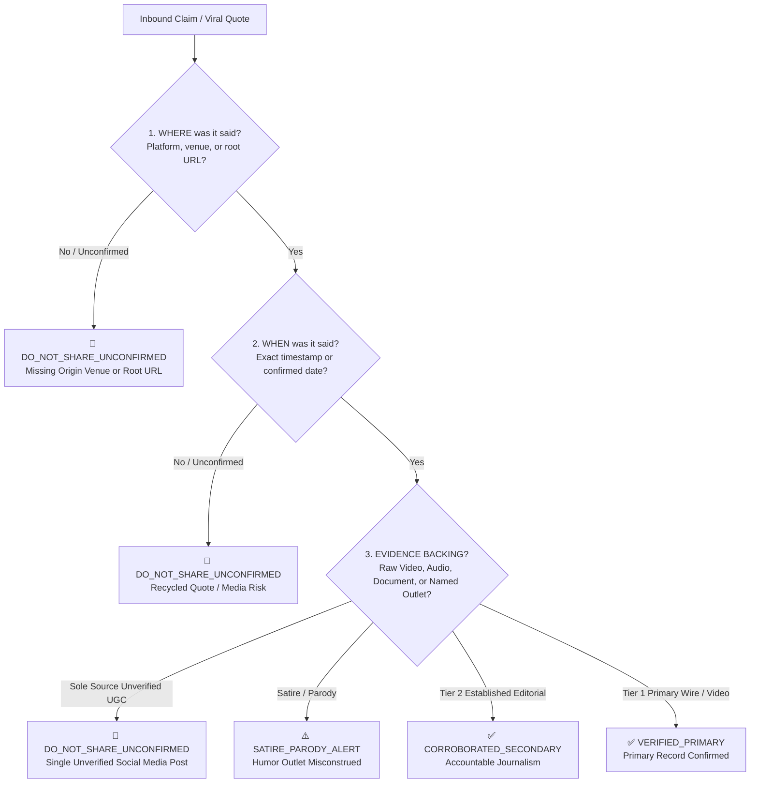

<div align="center">

# 🛡️ Epistemic Guard

**Model-Agnostic Provenance Auditing & Two-Sided Listening Engine**

[](https://www.python.org/downloads/)
[](https://docs.pydantic.dev/)
[](tests/)
[](LICENSE)

*A deterministic, zero-hallucination verification foundation to halt viral misinformation before emotional contagion spreads.*

</div>

---

## 📖 Overview

In modern information ecosystems, viral claims, quotes, and screenshots rapidly circulate during moments of high emotional volatility—often stripped of context, recycled from years past, originating from satire, or fabricated out of unverified social media posts.

**`epistemic-guard`** is an open-source, model-agnostic provenance auditing engine engineered to halt emotional contagion by answering three non-negotiable provenance questions with mathematical certainty.

---

## 🎯 Core Methodology: The 3 Provenance Questions

Before any claim or viral quote is cleared for sharing, `epistemic-guard` subjects it to three deterministic verification gates:



### 1. Where was it said?
*Identifies the physical podium, press conference, judicial venue, legislative floor, or canonical root URL.*
- If the venue is missing, ambiguous, or unverifiable, the claim is rejected.

### 2. When was it said?
*Verifies the exact publication datetime or broadcast timestamp.*
- Prevents the viral weaponization of **recycled historical quotes and out-of-context archive footage** presented as breaking news.

### 3. Is there video, audio, or a named outlet behind it?
*Separates empirical primary media and legally accountable journalism from anonymous social media threads.*
- Distinguishes Tier 1 wire services and Tier 2 investigative newsrooms with named bylines and published correction policies from unverified user-generated content (UGC) and satire.

> **The Invariant Rule:**
> If any of these three criteria are unmet—or if the sole cited source is an unverified social media post (X, TikTok, Reddit, Telegram)—the engine flags the claim as **`DO_NOT_SHARE_UNCONFIRMED`**.

---

## 🏛️ Deterministic Source Tiering Hierarchy

`epistemic-guard` implements deterministic domain auditing via [`config/source_tiers.yaml`](config/source_tiers.yaml) and `tldextract`:

| Tier | Classification | Description | Default Action |
| :--- | :--- | :--- | :--- |
| **Tier 1** | `TIER_1_PRIMARY` | Direct wire services (Reuters, AP), government/judicial registries (`.gov`, `.mil`), supranational bodies (UN, WHO), peer-reviewed science (`nature.com`, `arxiv.org`), and certified IFCN fact-checkers. | **Eligible for Primary Verification** |
| **Tier 2** | `TIER_2_ESTABLISHED_EDITORIAL` | Major newsrooms with formal editorial oversight, named reporter bylines, and transparent correction policies (e.g. NYT, BBC, WSJ, The Guardian). | **Eligible for Corroboration** |
| **Tier 3** | `TIER_3_SECONDARY_ANALYSIS` | Specialized trade publications, tech press, opinion commentary, regional outlets, and curated newsletters (e.g. TechCrunch, Wired, Axios). | **Requires Secondary Corroboration** |
| **Tier 4** | `TIER_4_USER_GENERATED` | Platforms where anyone can post without editorial oversight (X/Twitter, TikTok, Reddit, Telegram, YouTube). | **Flagged as Unconfirmed UGC if sole source** |
| **Tier 5** | `TIER_5_SATIRE_PARODY` | Satirical or parody publications whose headlines are frequently misquoted (The Onion, Babylon Bee, Clickhole). | **Immediate Satire Parody Alert** |
| **Unknown**| `TIER_UNKNOWN` | Unlisted domains or unregistered blogs. | **Conservative Suspicion (Hold)** |

---

## 📂 Repository Structure

```text
epistemic-guard/
├── pyproject.toml              # Build config, dependencies (PEP 517/621)
├── .env.example                # OpenAI-compatible & search environment template
├── .gitignore                  # Git exclusions for Python & environments
├── README.md                   # System documentation & methodology
├── config/
│   ├── source_tiers.yaml       # Deterministic domain tiering rules & TLD overrides
│   └── prompts.yaml            # Versioned prompt templates for claim & quote extraction
├── src/
│   └── epistemic_guard/
│       ├── __init__.py         # Public API exports
│       ├── config.py           # Pydantic Settings with OpenAI & search spec
│       ├── schemas.py          # Strict Pydantic v2 data contracts
│       ├── extraction/
│       │   ├── __init__.py
│       │   └── extractor.py    # Claim, quote & emotional framing extraction engine
│       ├── llm/
│       │   ├── __init__.py
│       │   └── client.py       # Model-agnostic structured LLM client
│       └── tools/
│           ├── __init__.py
│           ├── domain_auditor.py      # Deterministic URL auditor & source tiering
│           ├── search.py              # Pluggable SearchProvider (DuckDuckGo, Tavily, Mock)
│           ├── temporal.py            # Temporal drift & recycled content engine
│           └── provenance_resolver.py # Active 3-criteria provenance investigator
└── tests/
    ├── __init__.py
    ├── test_schemas.py             # Data contracts & validation test suite
    ├── test_domain_auditor.py      # Provenance rules & source tiering test suite
    ├── test_extractor.py           # Extraction & Phase 0/1 handoff test suite
    └── test_provenance_resolver.py # Active search, circular reporting & drift tests
```

---

## ⚡ Quickstart

### Prerequisites
- Python 3.11 or higher
- Recommended package manager: [`uv`](https://github.com/astral-sh/uv) or standard `venv`

### 1. Installation
Clone the repository and install dependencies:

```bash
# Using uv (fastest)
uv venv
source .venv/bin/activate  # On Windows: .venv\Scripts\activate
uv pip install -e ".[dev]"

# Or using standard pip
python -m venv .venv
source .venv/bin/activate  # On Windows: .venv\Scripts\activate
pip install -e ".[dev]"
```

### 2. Run the Unit Test Suite
Verify that all 33 deterministic unit tests pass:

```bash
pytest -v
```

---

## 💻 Programmatic Usage

### Example 1: Catching an Unverified Viral Social Media Claim

```python
from epistemic_guard import ClaimAuditRequest, DomainAuditor, EvidenceType, SourceRecord

auditor = DomainAuditor()

# Inbound viral post from X/Twitter with no primary media
request = ClaimAuditRequest(
    claim_text="Major city announces complete blackout starting tomorrow morning.",
    alleged_venue="X / Twitter Post",
    alleged_date="2026-11-19",
    sources=[
        SourceRecord(
            url="https://x.com/viral_anonymous/status/123456789",
            author_or_account="@viral_anonymous",
            evidence_type=EvidenceType.SOCIAL_MEDIA_POST,
            has_primary_media=False,
        )
    ],
    emotional_intensity_score=0.92,
)

result = auditor.evaluate_claim(request)

print("Verdict:", result.verdict)
# Output: ProvenanceVerdict.DO_NOT_SHARE_UNCONFIRMED

print("Shareable:", result.is_shareable)
# Output: False

print("Warning Flags:", result.warning_flags)
# Output: ['NO_PRIMARY_MEDIA_OR_NAMED_OUTLET', 'SOLE_SOURCE_UNVERIFIED_UGC']

print("Recommendation:", result.recommendation)
# Output: DO NOT SHARE (UNCONFIRMED). The sole source is an unverified social media post...
```

### Example 2: Verifying a Primary Wire Statement with Video

```python
from datetime import datetime, timezone
from epistemic_guard import ClaimAuditRequest, DomainAuditor, EvidenceType, SourceRecord

auditor = DomainAuditor()

# Statement backed by Reuters wire and video recording
request = ClaimAuditRequest(
    claim_text="Federal Reserve lowers benchmark interest rate by 25 basis points.",
    alleged_venue="Federal Reserve Press Briefing",
    alleged_date="2026-11-19",
    sources=[
        SourceRecord(
            url="https://www.reuters.com/markets/us/fed-rate-cut-2026",
            published_at=datetime(2026, 11, 19, 14, 30, tzinfo=timezone.utc),
            evidence_type=EvidenceType.VIDEO,
            has_primary_media=True,
            outlet="Reuters",
            quote_excerpt="The Federal Open Market Committee decided to lower the target range...",
        )
    ],
)

result = auditor.evaluate_claim(request)

print("Verdict:", result.verdict)
# Output: ProvenanceVerdict.VERIFIED_PRIMARY

print("Shareable:", result.is_safe_to_share())
# Output: True

print("Evidence Backing:", result.evidence.evidence_summary)
# Output: Backed by primary media (video/audio/document).
```

---

## ⚙️ Configuration & Model-Agnostic Settings

Epistemic Guard uses `pydantic-settings` to load environment variables from `.env` or system environment.

The configuration follows the **OpenAI-compatible specification**, enabling seamless plug-and-play with:
- **Local offline inference:** [Ollama](https://ollama.com/), [vLLM](https://github.com/vllm-project/vllm), [llama.cpp](https://github.com/ggerganov/llama.cpp)
- **Cloud inference:** OpenAI, Groq, Mistral, Together AI, or private corporate endpoints.

```ini
# .env sample
ENVIRONMENT=development
OPENAI_BASE_URL=http://localhost:11434/v1
OPENAI_API_KEY=dummy-local-key
OPENAI_MODEL_NAME=llama3.2
TEMPERATURE=0.0
REQUEST_TIMEOUT=30.0

SOURCE_TIERS_CONFIG_PATH=config/source_tiers.yaml
STRICT_TIMESTAMP_ENFORCEMENT=true
REQUIRE_PRIMARY_EVIDENCE_FOR_BREAKING=true
```

---

## 🗺️ Roadmap

- [x] **Phase 0:** Foundation, Repository Scaffold, Data Contracts, and Deterministic Source Tiering (Zero-Hallucination).
- [x] **Phase 1:** Model-Agnostic Claim, Quote & Emotional Framing Extraction (`ClaimExtractor`, `StructuredLLMClient`, `extract_and_audit`).
- [x] **Phase 2:** The 3-Criteria Provenance Retrieval Engine (`ProvenanceInvestigator`, `DuckDuckGoSearchProvider`, `TemporalAuditResult`, Circular Reporting Defense).
- [ ] **Phase 3:** Two-Sided Listening Topology & Multi-Perspective Synthesis.

---

## 📄 License

Apache License 2.0. See [LICENSE](LICENSE) for details.
