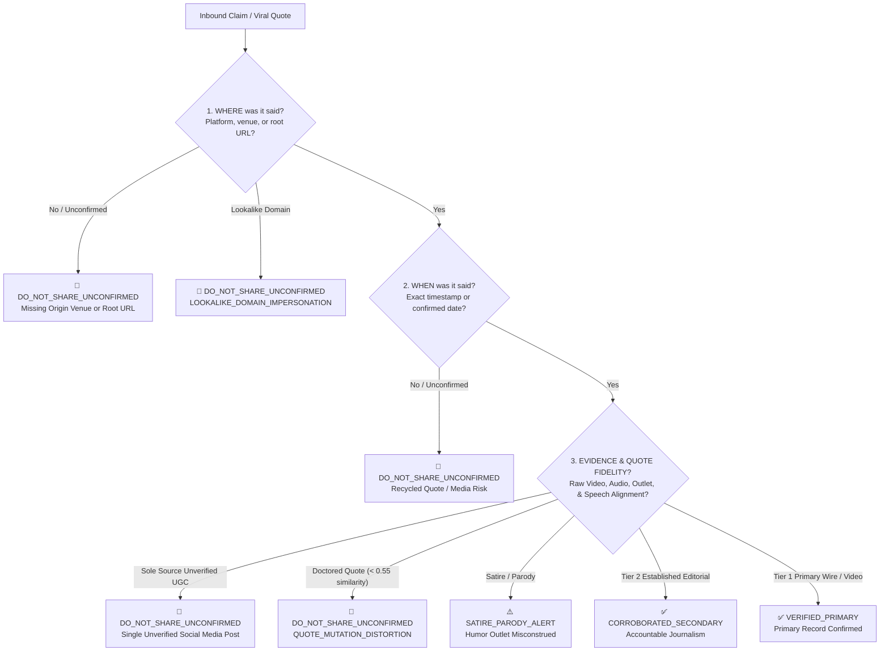

<div align="center">

# 🛡️ Epistemic Guard

**Model-Agnostic Provenance Auditing & Two-Sided Listening Engine**

[](pyproject.toml)
[](https://www.python.org/downloads/)
[](https://docs.pydantic.dev/)
[](tests/)
[](https://github.com/your-org/epistemic-guard/actions/workflows/ci.yml)
[](benchmarks/)
[](LICENSE)

*A deterministic, zero-hallucination verification foundation to halt viral misinformation before emotional contagion spreads.*

</div>

---

## 📖 Overview

In modern information ecosystems, viral claims, quotes, and screenshots rapidly circulate during moments of high emotional volatility—often stripped of context, recycled from years past, originating from satire, fabricated out of unverified social media posts, subtly doctored from real speeches, or published on deceptive lookalike domains.

**`epistemic-guard`** is an open-source, model-agnostic provenance auditing and multi-perspective listening engine engineered to halt emotional contagion by answering three non-negotiable provenance questions with mathematical certainty.

---

## 🎯 Core Methodology: The 3 Provenance Questions

Before any claim or viral quote is cleared for sharing, `epistemic-guard` subjects it to three deterministic verification gates:



### 1. Where was it said?
*Identifies the physical podium, press conference, judicial venue, legislative floor, or canonical root URL.*
- Rejects unconfirmed origins and intercepts deceptive typosquatted domains (`LOOKALIKE_DOMAIN_IMPERSONATION`).

### 2. When was it said?
*Verifies the exact publication datetime or broadcast timestamp.*
- Prevents the viral weaponization of **recycled historical quotes and out-of-context archive footage** presented as breaking news (`TEMPORAL_DRIFT_RECYCLED_CONTENT`).

### 3. Evidence Backing & Quote Integrity
*Separates empirical primary media and legally accountable journalism from anonymous social media threads, and verifies quote fidelity.*
- Distinguishes Tier 1 wire services and Tier 2 investigative newsrooms from UGC.
- Cross-references verbatim quotes against primary reporting to catch doctored or falsely attributed statements (`QUOTE_MUTATION_DISTORTION`).

> **The Invariant Rule:**
> If any of these three criteria are unmet—or if the sole cited source is an unverified social media post, lookalike domain, or mutated quote—the engine flags the claim as **`DO_NOT_SHARE_UNCONFIRMED`**.

---

## 🏛️ Deterministic Source Tiering & Adversarial Hardening

`epistemic-guard` implements deterministic domain auditing via [`config/source_tiers.yaml`](config/source_tiers.yaml) and `tldextract`:

| Tier | Classification | Description | Default Action |
| :--- | :--- | :--- | :--- |
| **Tier 1** | `TIER_1_PRIMARY` | Direct wire services (Reuters, AP), government/judicial registries (`.gov`, `.mil`), supranational bodies (UN, WHO), peer-reviewed science (`nature.com`, `arxiv.org`), and certified IFCN fact-checkers. | **Eligible for Primary Verification** |
| **Tier 2** | `TIER_2_ESTABLISHED_EDITORIAL` | Major newsrooms with formal editorial oversight, named reporter bylines, and transparent correction policies (e.g. NYT, BBC, WSJ, The Guardian). | **Eligible for Corroboration** |
| **Tier 3** | `TIER_3_SECONDARY_ANALYSIS` | Specialized trade publications, tech press, opinion commentary, regional outlets, and curated newsletters (e.g. TechCrunch, Wired, Axios). | **Requires Secondary Corroboration** |
| **Tier 4** | `TIER_4_USER_GENERATED` | Platforms where anyone can post without editorial oversight (X/Twitter, TikTok, Reddit, Telegram, YouTube) and lookalike domains. | **Flagged as Unconfirmed UGC if sole source** |
| **Tier 5** | `TIER_5_SATIRE_PARODY` | Satirical or parody publications whose headlines are frequently misquoted (The Onion, Babylon Bee, Clickhole). | **Immediate Satire Parody Alert** |
| **Unknown**| `TIER_UNKNOWN` | Unlisted domains or unregistered blogs. | **Conservative Suspicion (Hold)** |

### Adversarial Defenses (Phase 6)
- **Lookalike & Typosquatting Defense (`detect_lookalike_domain`):** Intercepts deceptive domains mimicking Tier 1/2 brands (e.g. `reuters-breaking-alert.com`, `bbc-news-alert.co`, `nytimes-online.org`) and downgrades them to Tier 4 with flag `LOOKALIKE_DOMAIN_IMPERSONATION`.
- **Quote-Mutation & Misattribution Auditor (`verify_quote_integrity`):** Compares verbatim quotes against retrieved primary reporting. If credible coverage exists covering the speaker/event but text alignment is $< 0.55$, flags `QUOTE_MUTATION_DISTORTION` and strictly blocks sharing.

---

## 📊 Benchmark Evaluation & Scorecard

`epistemic-guard` includes a 100% offline, reproducible benchmark evaluation suite spanning 16 diverse scenarios across 8 core epistemic categories in [`benchmarks/dataset.jsonl`](benchmarks/dataset.jsonl):

```bash
# Run the evaluation harness (completes in ~1.5s, zero API keys required)
python benchmarks/evaluate.py

# Raw JSON output for CI/automation pipelines
python benchmarks/evaluate.py --json
```

### Aggregate Performance Scorecard

| Epistemic Metric | Measured Score | Design Target | Status |
| :--- | :---: | :---: | :---: |
| **Overall Scenario Accuracy** | **100.0%** (16/16) | $\ge 95.0\%$ | ✅ PASSED |
| **Misinformation Block Recall** | **100.0%** (13/13) | $100.0\%$ | ✅ PASSED |
| **Verified Share Precision** | **100.0%** (3/3) | $100.0\%$ | ✅ PASSED |
| **Temporal Drift (Recycled) Recall** | **100.0%** | $100.0\%$ | ✅ PASSED |
| **Provenance Asymmetry Accuracy** | **100.0%** | $100.0\%$ | ✅ PASSED |
| **Harness Latency (16 scenarios)** | **~1.5s** | $< 3.0\text{s}$ | ✅ PASSED |

### Evaluation Scenarios Tested

1. **Category A: Fake Viral Quotes** (Fabricated CEO statements, unverified political leaks) $\to$ `DO_NOT_SHARE_UNCONFIRMED`.
2. **Category B: Recycled Old Media** (Historical pandemic lockdowns and blackout footage reshared as breaking) $\to$ `TEMPORAL_DRIFT_RECYCLED_CONTENT`.
3. **Category C: Circular Reporting / Echo Chambers** (Rumors repeating across social media forums without primary source) $\to$ `NO_PRIMARY_MEDIA_OR_NAMED_OUTLET`.
4. **Category D: Satire Misattribution** (The Onion, Babylon Bee articles shared as literal news) $\to$ `SATIRE_PARODY_ALERT`.
5. **Category E: Verified Primary Events** (Federal Reserve briefings, official NASA missions, C-SPAN testimony) $\to$ `VERIFIED_PRIMARY`.
6. **Category F: Asymmetric Discourse** (Debates where Side A is corroborated by wire reports while Side B relies on viral outrage) $\to$ `provenance_asymmetry_detected: true`.
7. **Category G: Quote Mutation / Distortion** (Real press conference with subtly doctored quote) $\to$ `QUOTE_MUTATION_DISTORTION`.
8. **Category H: Lookalike Domain Impersonation** (Typosquatted domain posing as wire service) $\to$ `LOOKALIKE_DOMAIN_IMPERSONATION`.

---

## 🖥️ Pre-Share Friction Studio & Bookmarklet

`epistemic-guard` serves a responsive, zero-build web interface at `GET /`:

```bash
uvicorn epistemic_guard.interfaces.api:app --host 0.0.0.0 --port 8000
# Open http://localhost:8000 in your browser
```

### Features
- **Single-Claim Quick Check:** Instant **Stop / Caution / Verified** visual friction banners, the 3 Provenance Checkboxes (*Where*, *When*, *Evidence*), emotional arousal meter, and warning badges.
- **Two-Sided Listening Studio:** Side-by-side steel-manned summaries and provenance asymmetry indicator.
- **Browser Bookmarklet:** 1-click browser button to highlight any quote or tweet on X, Reddit, or news sites and open the Friction Studio pre-filled (`http://localhost:8000/?claim=...`).

---

## 📂 Repository Structure

```text
epistemic-guard/
├── Dockerfile                  # Production container packaging (python:3.12-slim)
├── docker-compose.yml          # Container orchestration with optional Ollama service
├── pyproject.toml              # Build config, dependencies & entrypoints (PEP 517/621)
├── .env.example                # OpenAI-compatible & search environment template
├── .gitignore                  # Git exclusions for Python & environments
├── CONTRIBUTING.md             # Contribution guidelines & architecture invariants
├── LICENSE                     # Apache License 2.0
├── README.md                   # System documentation & methodology
├── .github/
│   └── workflows/
│       └── ci.yml              # GitHub Actions CI matrix (Python 3.11 & 3.12)
├── benchmarks/
│   ├── dataset.jsonl           # 16 reproducible ground-truth test cases
│   └── evaluate.py             # Precision/recall evaluation runner (Rich & JSON modes)
├── config/
│   ├── source_tiers.yaml       # Deterministic domain tiering rules & TLD overrides
│   └── prompts.yaml            # Versioned prompt templates for claim extraction & synthesis
├── src/
│   └── epistemic_guard/
│       ├── __init__.py         # Public API exports
│       ├── config.py           # Pydantic Settings with OpenAI & search spec
│       ├── schemas.py          # Strict Pydantic v2 data contracts
│       ├── extraction/
│       │   ├── __init__.py
│       │   └── extractor.py    # Claim, quote & emotional framing extraction engine
│       ├── graph/
│       │   ├── __init__.py
│       │   ├── state.py        # Shared LangGraph state schema
│       │   ├── nodes.py        # Extraction, audit, and synthesis graph nodes
│       │   └── workflow.py     # EpistemicGuardPipeline & compiled StateGraph
│       ├── interfaces/
│       │   ├── __init__.py
│       │   ├── cli.py          # Rich terminal CLI (audit-url, analyze)
│       │   ├── api.py          # FastAPI REST HTTP service (/v1/audit/url, /v1/analyze, GET /)
│       │   ├── web_ui.py       # Zero-build Pre-Share Web Friction Studio & Bookmarklet
│       │   └── mcp_server.py   # Model Context Protocol server for AI agent tools
│       ├── llm/
│       │   ├── __init__.py
│       │   └── client.py       # Model-agnostic StructuredLLMClient (OpenAI / Ollama)
│       └── tools/
│           ├── __init__.py
│           ├── domain_auditor.py       # Deterministic TLD, domain tier & lookalike detector
│           ├── quote_matcher.py        # Deterministic quote-mutation integrity auditor
│           ├── search.py               # DuckDuckGo, Tavily & Mock search providers
│           ├── temporal.py             # Date parsing & temporal drift detection
│           └── provenance_resolver.py  # ProvenanceInvestigator & circular reporting defense
└── tests/
    ├── test_benchmarks.py              # Automated benchmark verification tests
    ├── test_domain_auditor.py          # Unit tests for domain tiering & invariants
    ├── test_extractor.py               # Unit tests for claim extraction & emotional cues
    ├── test_interfaces.py             # Offline CLI, FastAPI, and MCP integration tests
    ├── test_phase6_hardening.py        # Unit tests for quote mutation, lookalikes & Web UI
    ├── test_provenance_resolver.py     # Unit tests for search & temporal drift
    ├── test_schemas.py                 # Unit tests for contracts & serialization
    └── test_workflow.py                # End-to-end LangGraph pipeline & asymmetry tests
```

---

## 🚀 Quickstart

### 1. Installation

```bash
git clone https://github.com/your-org/epistemic-guard.git
cd epistemic-guard

# Create and activate virtual environment
python -m venv .venv
source .venv/bin/activate  # On Windows: .venv\Scripts\Activate.ps1

# Install editable package with dev dependencies
pip install -e ".[dev]"
```

### 2. Environment Configuration

```bash
cp .env.example .env
```

`epistemic-guard` defaults to zero paid API keys:
- **Search:** `DuckDuckGoSearchProvider` works out-of-the-box without API keys.
- **LLM:** Works with any local server (`Ollama`, `vLLM`, `llama.cpp`) or cloud provider via OpenAI-compatible endpoints:

```ini
LLM_BASE_URL=http://localhost:11434/v1
LLM_API_KEY=ollama
LLM_MODEL_NAME=llama3.2:latest
SEARCH_PROVIDER=duckduckgo
```

---

## 🛠️ Developer & User Interfaces

### 1. Pre-Share Web Friction Studio (`GET /`)
Served at `http://localhost:8000/`. Includes the 1-click browser bookmarklet, single-claim quick check, and two-sided discourse listening.

### 2. Rich Terminal CLI

```bash
# Audit a single domain
epistemic-guard audit-url "https://theonion.com/article/123"

# End-to-end multi-perspective discourse audit
epistemic-guard analyze "Official Envoy: Trade accord ratified https://www.reuters.com/markets/trade-accord-2026" "OUTRAGE! Secret surrender: https://x.com/critic/123"

# Raw JSON output for automation scripts
epistemic-guard analyze "Breaking news post text" --json
```

### 3. FastAPI REST Microservice

```bash
uvicorn epistemic_guard.interfaces.api:app --host 0.0.0.0 --port 8000
```

- `GET  /` — Zero-build Pre-Share Web Friction Studio & Bookmarklet interface.
- `GET  /health` — Service liveness and version check.
- `POST /v1/audit/url` — Classify any domain into accountability tiers (`{"url": "..."}`).
- `POST /v1/analyze` — Run end-to-end two-sided listening synthesis (`{"texts": ["..."]}`).

### 4. Model Context Protocol (MCP) Server for AI Agents

Connect `epistemic-guard` directly to Claude Desktop, Cursor, or any MCP-enabled AI client:

```json
{
  "mcpServers": {
    "epistemic-guard": {
      "command": "epistemic-guard-mcp"
    }
  }
}
```

**Exposed MCP Tools:**
- `audit_source_url(url: str)`: Classifies sources into Tiers 1–5 before citations.
- `check_viral_claim(claim_text: str)`: Verifies single claims against Where, When, and Primary Media.
- `listen_two_sides(texts: list[str])`: Executes two-sided synthesis, steel-manning, and asymmetry checks.

---

## 🐳 Docker Deployment

```bash
# Start API service & Pre-Share Web Studio on port 8000
docker compose up -d

# Start with optional local Ollama LLM service
docker compose --profile local-llm up -d
```

---

## 🗺️ Roadmap

- [x] **Phase 0:** Foundation, Repository Scaffold, Data Contracts, and Deterministic Source Tiering (Zero-Hallucination).
- [x] **Phase 1:** Model-Agnostic Claim, Quote & Emotional Framing Extraction (`ClaimExtractor`, `StructuredLLMClient`, `extract_and_audit`).
- [x] **Phase 2:** The 3-Criteria Provenance Retrieval Engine (`ProvenanceInvestigator`, `DuckDuckGoSearchProvider`, `TemporalAuditResult`, Circular Reporting Defense).
- [x] **Phase 3:** Two-Sided Listening Topology & Multi-Perspective Synthesis (`EpistemicGuardPipeline`, `LangGraph`, Steel-Manned Summaries & Provenance Asymmetry).
- [x] **Phase 4:** Developer & User Interfaces (`Rich` CLI, `FastAPI` Service & `MCP` Agent Server).
- [x] **Phase 5:** Benchmark Evaluation Dataset, Precision/Recall Harness & Open-Source Release Polish (`benchmarks/`, `Dockerfile`, `docker-compose.yml`, CI/CD, `CONTRIBUTING.md`, `LICENSE`).
- [x] **Phase 6:** Pre-Share Web Friction UI, Quote-Mutation Integrity Auditing & Adversarial Domain Hardening (`quote_matcher.py`, `detect_lookalike_domain`, `web_ui.py`, bookmarklet & 16-case benchmark suite).

---

## 📄 License

Apache License 2.0. See [LICENSE](LICENSE) for details.
