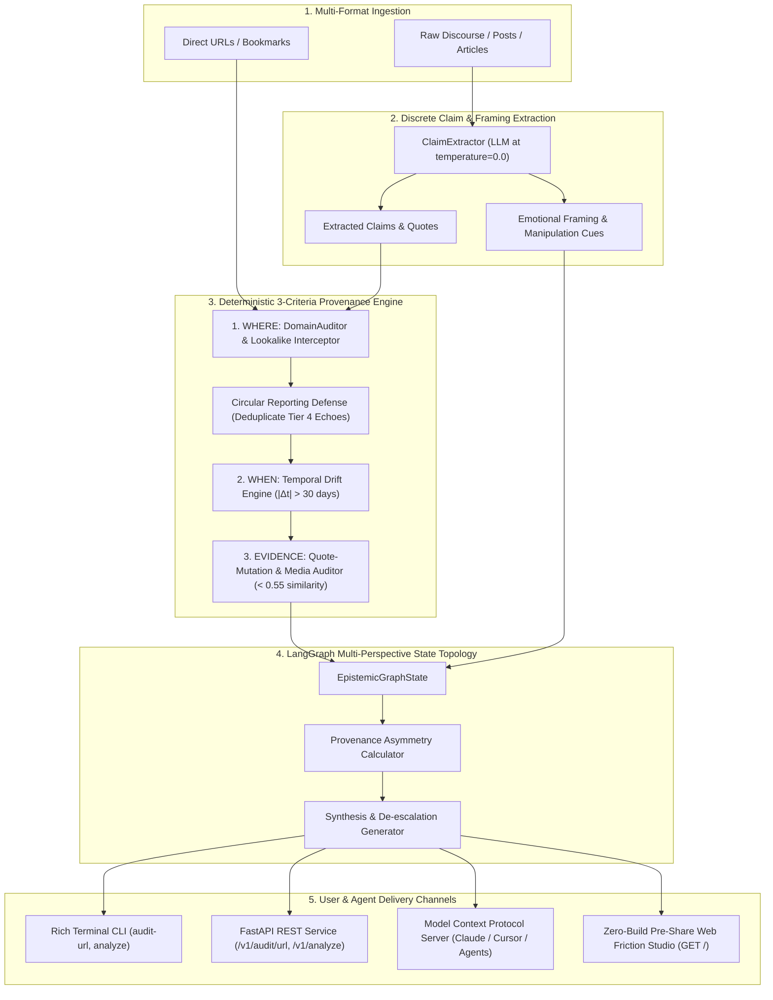
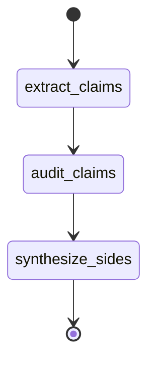

# System Architecture & Technical Specifications

This document provides a technical specification of the core architecture, deterministic invariants, and stateful verification graphs powering **`epistemic-guard`**.

---

## 1. High-Level System Topology

`epistemic-guard` decouples empirical verification into a two-stage cognitive pipeline:
1. **Deterministic Verification & Provenance Auditing:** Mathematical invariants, suffix-tree domain tiering, regex-based lookalike detection, sliding-window quote similarity, and temporal delta computations executed strictly in pure Python.
2. **Model-Agnostic Structural Synthesis:** Low-temperature structured extraction and multi-perspective steel-manning using an OpenAI-compatible interface (`StructuredLLMClient`) that operates across local models (`Ollama`, `vLLM`) and hosted APIs.

---

## 2. Core Invariants & Deterministic Verification

Traditional LLM fact-checking pipelines suffer from hallucination, training cutoff drift, and susceptibility to emotional rhetoric. `epistemic-guard` addresses this by enforcing **strict deterministic invariants**:

### Invariant 1: The Epistemic Invariant Rule
> A claim is strictly classified as **`DO_NOT_SHARE_UNCONFIRMED`** and `is_shareable = False` unless it satisfies:
> 1. **Verified Origin (`Where`):** Known reputable domain (Tier 1 Primary or Tier 2 Editorial) without lookalike spoofing.
> 2. **Temporal Alignment (`When`):** No temporal drift ($|\Delta t| \le 30\text{ days}$) or stale historical media recycling.
> 3. **Accountable Corroboration (`Evidence`):** Supported by verified primary video/audio, government records, or named editorial wire coverage. Uncorroborated Tier 4 (social media) citations are unconditionally rejected.

### Invariant 2: Python-Enforced Quantitative Metrics
All numerical counts, percentages, and verdict aggregations are calculated directly in Python:
- `total_claims = len(claims)`
- `verified_shareable_count = sum(1 for c in claims if c.audit.is_shareable)`
- `unconfirmed_blocked_count = sum(1 for c in claims if not c.audit.is_shareable)`
- `recycled_content_count = sum(1 for c in claims if c.audit.when.is_recycled)`
- `average_emotional_arousal = mean(c.emotional_framing.arousal_score)`

The LLM is strictly forbidden from counting or scoring metrics.

---

## 3. The 3 Provenance Retrieval & Verification Gates

### Gate 1: Where Was It Said? (Domain Auditor & Lookalike Defense)
Located in `src/epistemic_guard/tools/domain_auditor.py`.

1. **Suffix-Tree Domain Classification:**
   - Extracts apex registered domain using `tldextract`.
   - Matches against `config/source_tiers.yaml` (Tier 1 Primary to Tier 5 Satire).
   - Resolves FQDN overrides (e.g., `news.bbc.co.uk`) and TLD-level fallbacks (`.gov`, `.mil`, `.edu`).

2. **Adversarial Lookalike Domain Detection (`detect_lookalike_domain`):**
   - Defends against typosquatting, hyphenation stuffing, and suffix imitation:
     $$\text{Pattern: } \text{brand} + \text{deceptive-modifier} \quad \text{or} \quad \text{imitation prefix/suffix}$$
   - Examples intercepted: `reuters-breaking.com`, `bbc-news-live.co`, `c-span-wire.com`.
   - When detected: Forcefully classified as **Tier 4 (UGC / Unverified)**, assigned flag `LOOKALIKE_DOMAIN_IMPERSONATION`, and immediately blocked from sharing.

### Gate 2: When Was It Said? (Temporal Drift & Recycled Media)
Located in `src/epistemic_guard/tools/temporal.py`.

1. **Date Extraction:**
   - Detects structured publication timestamps (`published_date` metadata).
   - Parses dates embedded in URL path structures (e.g., `/2021/02/16/power-grid/`).
   - Normalizes text dates via `python-dateutil`.

2. **Temporal Consistency Evaluation (`evaluate_temporal_consistency`):**
   Given claimed event date $t_{\text{claim}}$ (or retrieval reference time $t_{\text{ref}}$) and earliest verified primary source date $t_{\text{source}}$:
   $$\Delta t = t_{\text{ref}} - t_{\text{source}}$$
   - If $\Delta t > 30\text{ days}$ and the discourse presents the event as breaking news:
     $$\text{is\_recycled} = \text{True}, \quad \text{warning\_flags} \mathrel{+}= [\text{"TEMPORAL\_DRIFT\_RECYCLED\_CONTENT"}]$$
   - Prevents stale footage (e.g., a 2021 blackout or a 2019 protest) from triggering panic during breaking events.

### Gate 3: Evidence Backing & Quote Integrity
Located in `src/epistemic_guard/tools/quote_matcher.py`.

1. **Circular Reporting Defense:**
   - Viral misinformation often cites multiple cross-referencing blogs, tweets, or forum threads.
   - `ProvenanceInvestigator` filters out all Tier 4 UGC hits. Multiple independent Tier 4 citations **cannot** escalate a claim to `CORROBORATED_SECONDARY` or `VERIFIED_PRIMARY`.
   - Only Tier 1 wires or Tier 2 investigative outlets constitute valid corroboration.

2. **Quote-Mutation & Misattribution Auditor (`verify_quote_integrity`):**
   - High-impact quotes are frequently doctored: swapping a word, changing polarity, or fabricating a quote attributed to an authentic press briefing.
   - Algorithm:
     - Normalizes tokens (lowercase, strip punctuation, remove stop-words).
     - Calculates token Jaccard similarity:
       $$J(T_q, T_s) = \frac{|T_q \cap T_s|}{|T_q \cup T_s|}$$
     - Executes sliding-window character matching using `difflib.SequenceMatcher`:
       $$\text{score} = \max_{w \in \text{windows}} \text{SequenceMatcher}(Q, w).\text{ratio}()$$
     - Composite Score:
       $$\text{similarity} = 0.4 \times J(T_q, T_s) + 0.6 \times \text{score}$$
   - **Mutation Decision Boundary:** If authoritative Tier 1/2 news coverage of the event exists, but the best quote match score is $< 0.55$, the engine triggers:
     $$\text{warning\_flags} \mathrel{+}= [\text{"QUOTE\_MUTATION\_DISTORTION"}], \quad \text{is\_shareable} = \text{False}$$

---

## 4. LangGraph Multi-Perspective State Topology

Located in `src/epistemic_guard/graph/`.

The orchestration is implemented as a compiled state graph (`StateGraph[EpistemicGraphState]`):

### State Schema (`EpistemicGraphState`)
- `raw_texts: list[str]`: Inbound discourse statements or articles.
- `extracted_claims: list[ExtractedClaim]`: Structured claim and quote entities.
- `audited_claims: list[ClaimWithAudit]`: Claims paired with deterministic provenance results.
- `perspectives: list[NarrativeSideSummary]`: Per-narrative perspective breakdowns.
- `final_report: Optional[TwoSidedListeningReport]`: Final consolidated report.

### Node Functions
1. **`extract_claims_node`:** Ingests raw text, identifies speaker bylines, verbatim quotes, alleged venues, and emotional manipulation cues.
2. **`audit_claims_node`:** Dispatches each claim to `ProvenanceInvestigator`, querying registered search providers (`DuckDuckGoSearchProvider`, `TavilySearchProvider`, or `MockSearchProvider`) and evaluating the 3 provenance criteria.
3. **`synthesize_sides_node`:**
   - Partitions claims by `narrative_side` ("Side A", "Side B", "Neutral").
   - Computes deterministic perspective metrics.
   - Detects **Provenance Asymmetry**:
     $$\text{Asymmetry} = (\text{verified}_{\text{Side A}} > 0 \land \text{verified}_{\text{Side B}} == 0) \lor (\text{verified}_{\text{Side B}} > 0 \land \text{verified}_{\text{Side A}} == 0)$$
   - Prompts the model to draft steel-manned summaries of both sides and a calm, non-preachy `deescalation_guidance` grounded in provenance.

---

## 5. Security & Boundary Architecture

- **Zero Arbitrary Execution:** No arbitrary shell commands or code execution occurs during inference.
- **Model Agnostic Isolation:** Structured output validation is enforced by Pydantic v2 schemas; non-conforming model outputs trigger deterministic fallback objects rather than pipeline failures.
- **Offline Determinism:** Every component can run fully isolated without internet access using `MockSearchProvider` and local LLM endpoints.
